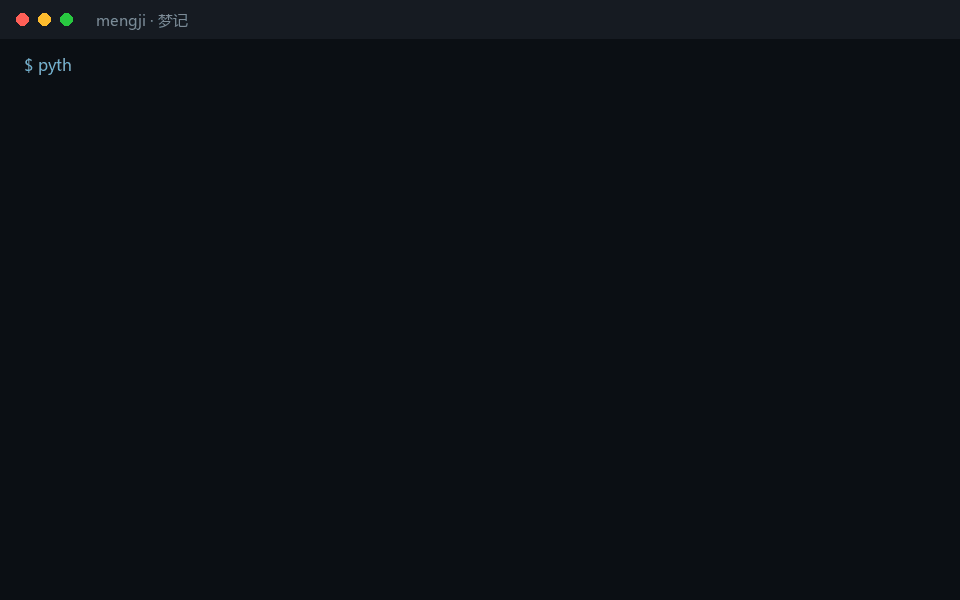
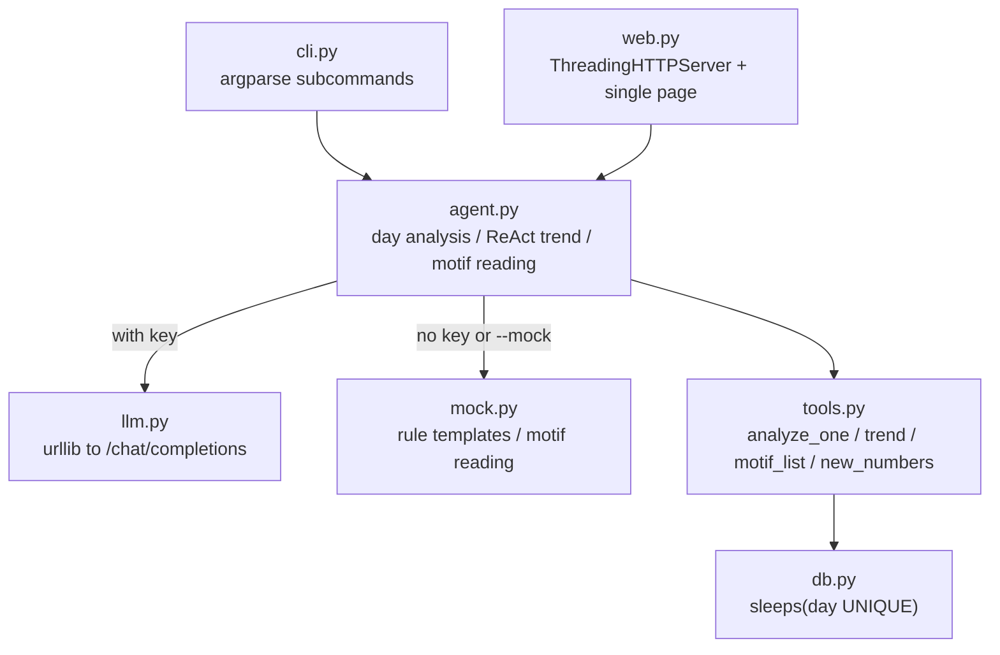

# Mengji 梦记

[](https://github.com/wushiyi105-jpg/mengji/actions)
[]()
[](./LICENSE)
[](https://codecov.io/gh/wushiyi105-jpg/mengji)



Spend a minute each day recording three things: how long you slept, what you would score it, and what you dreamt. You get an explanation for the day, averages and low-sleep streaks for a period, and a reading of your dream — cultural associations only, never "this is what it means", never a diagnosis of insomnia.

Sleep is the easiest thing to fudge with a feeling. You think the week went fine; the records show three days under six hours. You think you dream every night; the log shows the dreams cluster in two days. Mengji keeps all three notes, so you look at the numbers first and the feeling second.

## Features

- **One record per day**: duration (0–24 h), self-rated quality 1–5, a note, and the dream text, stored in SQLite. Logging the same day again updates it instead of stacking duplicate rows.
- **Rule-based duration and quality flags**: under 6 hours is "short", over 9.5 is "long", the rest is the usual range; words like "woke up several times", "tossed and turned" or "many dreams" in the note get listed separately.
- **Two layers for a single day**: rules make the hard calls, the model only writes a summary, plausible factors (phrased as possibilities) and actions for tonight. A summary or advice item containing a number absent from the record is dropped; the summary is cleared and falls back to "slept X hours, self-rated Y".
- **Trends computed locally**: days, average duration, min and max, population standard deviation, average quality, best and worst day, length of the low-sleep streak, days with dreams — all done in `tools.trend`.
- **ReAct for the trend**: the model may call `trend_stats` first and read raw days with `recent_sleep`, capped at 12 steps; its summary may only quote numbers already in the statistics, otherwise the local wording is used.
- **Dreams stay associative**: eight common motifs ship in the box (water, flying, falling, being chased, exams, family, teeth, getting lost). A motif is kept only if a matching word appears in the dream text, with alias folding (e.g. "exam paper" folds into "exams"). Every reading carries "cultural association, not dream interpretation, not a diagnosis".
- **No overreach**: no insomnia or sleep-apnoea conclusions, no medication or dosage advice; a doctor is suggested when relevant.
- **Offline mode**: with no key you can still log, list and compute trends; analysis uses rule templates and dreams get one line from the motif table, with an explicit note that it is template judgement.
- **Two entry points**: CLI and web.

## Quick start

```bash
git clone https://github.com/wushiyi105-jpg/mengji.git
cd mengji
python -m mengji seed
python -m mengji list
python -m mengji log 6.2 --quality 2 --note "asleep at two, woke twice"
python -m mengji analyze
python -m mengji trend --days 14
```

With a model:

```bash
cp .env.example .env
# set LLM_API_KEY; defaults are https://api.deepseek.com + deepseek-flash
```

```bash
LLM_BASE_URL=https://open.bigmodel.cn/api/paas/v4 LLM_MODEL=glm-4.6 python -m mengji analyze
```

Web UI:

```bash
python -m mengji web --port 8774
# http://127.0.0.1:8774
```

`data/sleep-sample.json` holds ten sample days; `seed` converts `days_ago` into dates, and four of them carry dream text so `trend` and `dream` have something to work on.

Run in Docker (the container uses the default port 8774):

```bash
docker build -t mengji .
docker run -p 8774:8774 mengji
```

## Command reference

| Command | What it does |
| --- | --- |
| `seed` | Load sample records |
| `log <hours> [--quality 1-5] [--dream] [--note] [--date]` | Log a day; date defaults to today |
| `list [--limit N]` / `show [date]` | Record list / one day in detail |
| `analyze [date]` | Analyse one day (rules plus model) |
| `dream [date]` | Read that day's dream |
| `trend [--days 14]` | Trend over a period (3–60 days) |
| `rm <date>` / `stats` / `web` | Delete a day / stats / web |

Global flags: `--mock`, `--json`, `--model`, `--base-url`, `--api-key`, `--db`.

## 🤔 Why not just ask a general LLM

A general model can listen to your sleep description and give advice. Mengji adds the three things it cannot:

1. **Statistics are computed locally** — average duration, volatility and low-sleep streaks are calculated locally; the model writes one summary and may only cite numbers already in the statistics, so the same records compute the same conclusion.
2. **Dreams stay associative** — eight motifs ship built in (water, flying, falling, being chased, exams, family, teeth, getting lost), a motif is kept only if a matching word appears in the dream text, and every reading carries "cultural association, not interpretation, not diagnosis" without predicting fortune.
3. **Records stay local** — sleep and dreams are private; they sit in local SQLite and are not uploaded, and a model call sends only today's entry.
4. **Works offline** — recording, listing, trends and rule checks are local; without a key the analysis is template-based and dreams get one line from the motif table, with the template nature stated.

## 🎯 Use cases

- **A minute a day**: how long you slept, a score out of five, what you dreamt; a week later you can see which nights were genuinely short.
- **A monthly trend**: average duration, average quality and whether a three-day short streak exists — more reliable than "this week felt fine".
- **A dream that keeps returning**: write it down and see the motif as a stress clue, rather than looking up whether dreaming of lost teeth is an omen.

## 🗺 Roadmap

- **Link with Xinyu**: sleep and mood on one timeline to see whether low days coincide with short sleep.
- **Sleep target**: set a target duration and track the hit rate, not just the average.
- **Motif counts**: which motifs recur over a period, with counts instead of one reading at a time.
- **Export for a doctor**: a table of a period's records that makes an appointment easier to explain.
- **Gentle nudges**: one reminder after a short-sleep streak, not a daily pop-up.

## ❓ FAQ

**Where do I get an API key?**
The project ships without one. It talks to DeepSeek (`https://api.deepseek.com`) by default — set `LLM_API_KEY`; any OpenAI-compatible endpoint works.

**Where is data stored, and is it uploaded?**
Sleep records are in local SQLite; a model call sends today's entry, not the historical trend.

**Does it work without a key?**
Recording, listing and trends work, with rule-template analysis and motif-table dream notes; only the wording is less detailed.

**How do I switch models?**
Change `LLM_BASE_URL`, `LLM_MODEL` and `LLM_API_KEY`, or override with `--model`.

**Are the dream readings accurate?**
It makes no such promise. Motif associations are cultural reference points, not interpretation or diagnosis; a recurring dream is better treated as a stress clue than a prophecy.

## How it works



Three trade-offs:

1. **Statistics never go to the model.** Asking a model for an average, a standard deviation or a low-sleep streak is a gamble. `tools.trend` computes it once with `statistics.pstdev`; the model may only write its summary inside the whitelist of those numbers, and if it strays the local `trend_text` takes over — which also says outright that fewer than three days cannot show a streak.
2. **Dreams come without promises.** There is no agreed dictionary of dream symbols, so this tool does two things: recognise motifs, give one "often associated with …" line, and always state that this is neither interpretation nor diagnosis. A motif must be traceable to a word in the dream text, so a model inventing "family" for a dream without relatives gets dropped.
3. **The quality score is yours.** It never pretends to infer deep-sleep share from duration — without a tracker there is no such data. So a day's conclusions stay inside the three things you wrote: duration, your score, your note.

One SQLite file with `check_same_thread=False` + `threading.Lock`, default `data/mengji.db`, overridable via `MENGJI_DB`. `log` writes with `ON CONFLICT(day) DO UPDATE ... RETURNING id`, so editing a day is idempotent.

## Layout

```
mengji/
├── mengji/
│   ├── __init__.py / __main__.py
│   ├── llm.py     # OpenAI-compatible client + .env loader
│   ├── db.py      # sleeps(day UNIQUE)
│   ├── tools.py   # statistics, quality labels, motif table, number checks
│   ├── mock.py    # offline rule templates and motif reading
│   ├── agent.py   # day analysis, ReAct trend, dream reading
│   ├── cli.py     # command line
│   └── web.py     # web UI
├── data/sleep-sample.json
├── tests/test_mengji.py
├── assets/demo.gif
├── .github/workflows/test.yml
├── pyproject.toml
├── README.md / README.en.md
└── CHANGELOG.md / SECURITY.md / CODE_OF_CONDUCT.md / CONTRIBUTING.md
```

## Author

Luo Zhizhi · 15071889700

MIT License, Copyright (c) 2026 wushiyi105-jpg
