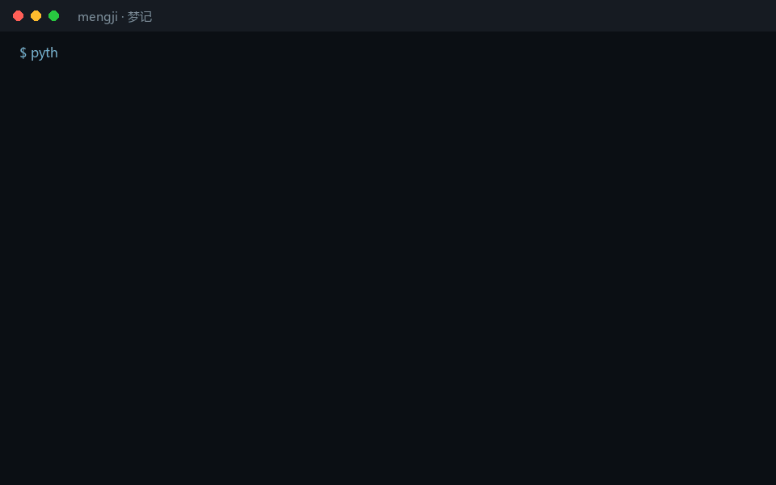
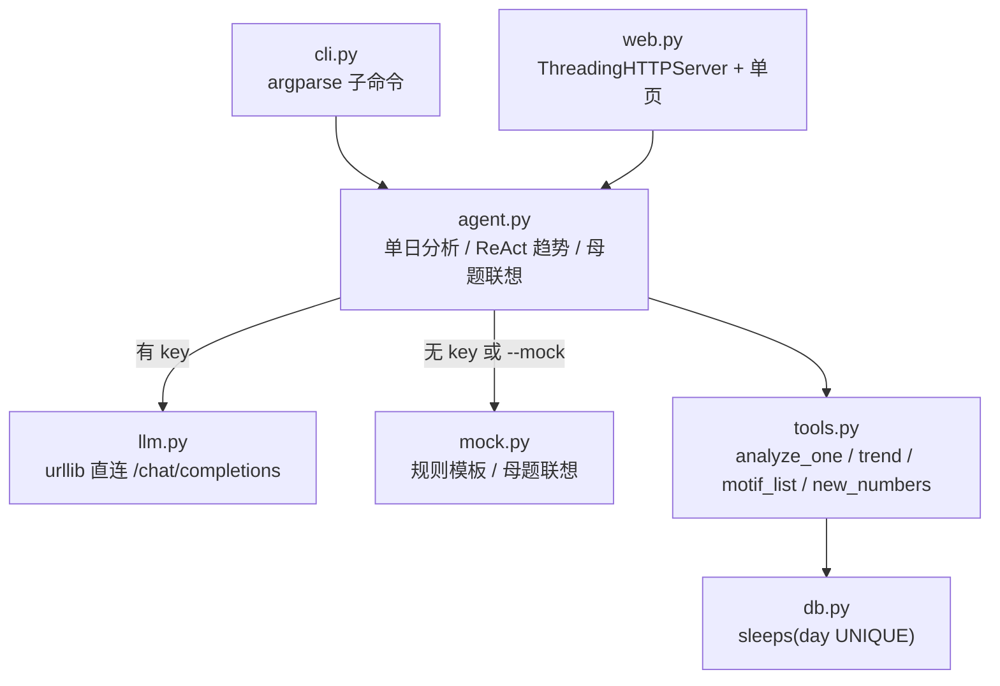

# 梦记 mengji

[](https://github.com/wushiyi105-jpg/mengji/actions)
[]()
[](./LICENSE)
[](https://codecov.io/gh/wushiyi105-jpg/mengji)



每天花一分钟记三件事:睡了几个小时、自己打几分、梦见了什么。它给单日的解释,给一段时间的平均数与连续低睡段提醒,也读你的梦——但只给文化联想,不说这是解梦,更不诊断失眠。

睡眠这件事最容易被"感觉"糊弄。你觉得这周还行,数据却是连续三天不到六小时;你觉得天天做梦很失常,回看记录才发现梦只集中在那两天。梦记把这三样都随手记下来,先看数,再谈感觉。

## 功能特性

- **一天的记录**:时长(0–24 小时)、自评质量 1–5、备注、梦境文本,存进 SQLite,同一天再记就是改,不会堆出两条。
- **时长与质量的规则判断**:`<6` 小时标"偏少"、`>9.5` 小时标"偏多"、其余落在常见区间;备注里出现"醒了几次""翻来覆去""多梦"这类词,单独列进值得注意。
- **单日分析两层**:规则先给硬判断,模型只写摘要、可能的影响(用"可能")和今晚能做的动作;摘要与建议里出现记录之外的数字,该条直接丢,摘要整段清空并退回"睡了 X 小时,自评 Y"。
- **趋势本地算**:天数、平均时长、最短最长、总体标准差、质量均分、最好最差的一天、连续低睡段天数、有梦的天数,全在 `tools.trend` 里算完。
- **趋势走 ReAct**:模型可以先调 `trend_stats` 再看数,也能 `recent_sleep` 拉原始记录,上限 12 步;综述里只能引用统计里已有的数字,越界就改用本地结论。
- **梦只做联想**:内置 8 类常见母题(水、飞、坠落、被追、考试、亲人、牙齿、迷路),母题必须在梦境原文里找得到词才保留,还给了词表别名归并(比如"试卷"归到"考试")。输出固定带一句"文化联想,不是解梦,也不是诊断"。
- **不越界**:不下失眠、睡眠呼吸暂停这类结论,不给药物与剂量建议;需要时提示就医。
- **离线模式**:没有 key 也能记、能看列表、能算趋势;分析只做规则模板,梦只按母题表给一句联想,并明说是模板判断。
- **双入口**:CLI 与网页。

## 快速开始

```bash
git clone https://github.com/wushiyi105-jpg/mengji.git
cd mengji
python -m mengji seed
python -m mengji list
python -m mengji log 6.2 --quality 2 --note "两点才睡,中间醒了两次"
python -m mengji analyze
python -m mengji trend --days 14
```

接模型:

```bash
cp .env.example .env
# 填 LLM_API_KEY,默认 https://api.deepseek.com + deepseek-flash
```

```bash
LLM_BASE_URL=https://open.bigmodel.cn/api/paas/v4 LLM_MODEL=glm-4.6 python -m mengji analyze
```

网页:

```bash
python -m mengji web --port 8774
# http://127.0.0.1:8774
```

`data/sleep-sample.json` 是 10 天示例记录,`seed` 会把 `days_ago` 换算成日期,其中 4 天带梦境文本,方便直接看 `trend` 与 `dream`。

Docker 运行(容器内用默认端口 8774):

```bash
docker build -t mengji .
docker run -p 8774:8774 mengji
```

## 命令参考

| 命令 | 作用 |
| --- | --- |
| `seed` | 导入示例记录 |
| `log <小时> [--quality 1-5] [--dream] [--note] [--date]` | 记一天,日期默认今天 |
| `list [--limit N]` / `show [日期]` | 记录列表 / 某一天详情 |
| `analyze [日期]` | 单日分析(规则 + 模型) |
| `dream [日期]` | 读这天的梦 |
| `trend [--days 14]` | 一段时间的趋势(3–60 天) |
| `rm <日期>` / `stats` / `web` | 删一天 / 统计 / Web |

全局开关 `--mock`、`--json`、`--model`、`--base-url`、`--api-key`、`--db`。

## 🤔 为什么不用通用大模型直接问

通用模型能听你描述睡眠然后给建议,但梦记补的是它做不到的三件事:

1. **统计本地算** —— 平均时长、波动、连续低睡天数都由本地算,模型只写一段摘要,且只能引用统计里已有的数字;同一批记录算两次,结论一致。
2. **梦只做联想** —— 内置八类母题(水、飞、坠落、被追、考试、亲人、牙齿、迷路),母题必须在梦境原文里找得到词才保留,输出固定带一句「文化联想,不是解梦,也不是诊断」,不预言吉凶。
3. **记录留在本地** —— 睡眠与梦境是很私人的记录,存在本地 SQLite,不上传;调模型时只发当天这一条。
4. **离线能用** —— 记录、列表、趋势、规则判断都本地;没有 key 时分析只做模板,梦只按母题表给一句联想,并明说是模板。

## 🎯 适用场景

- **每天花一分钟记**:睡了多久、自己打几分、梦见了什么;一周后回看,知道哪几天真的没睡够。
- **月度看趋势**:平均时长、质量均分、有没有连续三天偏少,比「感觉这周还行」可靠。
- **同一个梦反复出现**:写下来看母题是什么,当压力线索用,而不是去查「梦见掉牙是不是凶兆」。

## 🗺 Roadmap

- **与心语联动**:睡眠与情绪放一张时间线上,看低落的那几天是不是也没睡好。
- **睡眠目标**:设一个目标时长,统计达标率,而不是只看平均。
- **母题统计**:一段时间里哪些母题反复出现,给出次数而不是每次单独看。
- **导出给医生**:把一段时间的记录导成表格,就诊时能说清楚。
- **温和提醒**:连续低睡时提醒一次,不每天弹。

## ❓ FAQ

**API key 从哪来?**
项目不带 key。默认接 DeepSeek(`https://api.deepseek.com`),注册后填 `LLM_API_KEY`;任何 OpenAI 兼容端点都能换。

**数据存在哪,会上传吗?**
睡眠记录在本地 SQLite;调模型时只发当天这一条,不发历史趋势。

**没有 key 能不能用?**
能记、能看列表与趋势,分析走规则模板,梦按母题表给联想;只是话不如模型细。

**怎么换模型?**
改 `LLM_BASE_URL`、`LLM_MODEL`、`LLM_API_KEY`,或用 `--model` 覆盖。

**梦的解读准不准?**
它不承诺准。母题联想是文化层面的参考,不是解梦也不是诊断;反复出现的梦更值得当压力线索看,而不是当预言。

## 工作原理



三处取舍:

1. **统计不交给模型**。平均时长、标准差、连续低睡段,让模型算就是碰运气。`tools.trend` 用 `statistics.pstdev` 一次算完,模型只能在统计数字的白名单内写综述;越界就退回本地算好的 `trend_text`,样本不到三天时它会明说"看不出连续段"。
2. **梦不承诺含义**。梦的符号没有公认解释表,所以这里只做两件事:认出母题,给一句"常和……有关"的联想,并固定声明这不是解梦也不是诊断。母题必须能在梦境原文里找到词,模型编出来的(比如梦里没有家人却写"亲人")直接丢。
3. **质量分是你自己打的**。它不假装能从时长推出深睡比例——没有手环数据就没有。所以单日结论只围绕"你写的时长、你打的分、你记的备注"三样,别的都不编。

SQLite 单文件,`check_same_thread=False` + `threading.Lock`,默认 `data/mengji.db`,`MENGJI_DB` 可改。`log` 用 `ON CONFLICT(day) DO UPDATE ... RETURNING id` 做幂等写入,同一天改记录不会产生重复行。

## 目录结构

```
mengji/
├── mengji/
│   ├── __init__.py / __main__.py
│   ├── llm.py     # OpenAI 兼容客户端 + .env 加载
│   ├── db.py      # sleeps(day UNIQUE)
│   ├── tools.py   # 统计、质量判定、母题表、数字校验
│   ├── mock.py    # 离线规则模板与母题联想
│   ├── agent.py   # 单日分析、ReAct 趋势、梦境联想
│   ├── cli.py     # 命令行
│   └── web.py     # Web UI
├── data/sleep-sample.json
├── tests/test_mengji.py
├── assets/demo.gif
├── .github/workflows/test.yml
├── pyproject.toml
├── README.md / README.en.md
└── CHANGELOG.md / SECURITY.md / CODE_OF_CONDUCT.md / CONTRIBUTING.md
```

## 作者

罗之之 · 15071889700

MIT License,Copyright (c) 2026 wushiyi105-jpg
